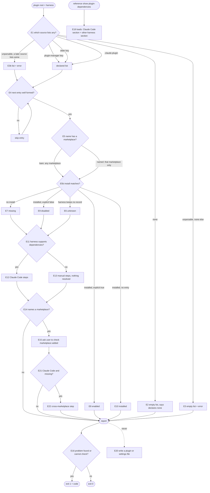

# dependencies — what a plugin needs, what is missing, what to do

## What

A plugin can need other plugins. Claude Code enforces that itself: it installs missing dependencies and refuses to
load a plugin whose dependency is missing or disabled. Every other harness ignores the field, so the plugin installs
and fails later with nothing to say why.

This capability fills that gap. It reads the dependencies a plugin lists, checks them against what the running harness
has installed and enabled, and reports each one's state with the steps the user can run. It is the agent-level
equivalent of `depcheck` or `knip`: one shared answer to "what does this plugin declare, and is it there?".

It is **read-only**. It never installs, enables, or removes a plugin.

**Non-goals:**

- Installing, enabling, or removing plugins.
- Comparing versions. A requested version is reported, not checked.
- Finding dependencies a plugin uses but did not list, or lists but never uses (the `knip` half). Not in v1.
- Reference-keyed overrides: alias, default marker, pin (a separate node, #110).
- Telling whether a marketplace lists a plugin (the user's marketplace may lack it; only its author can fix that).
- Knowing which marketplaces a harness has added. No verified query exists, so the check asks the user.

**Key terms:** see [glossary](../glossary.md). *State* is one of `enabled`, `installed` (installed, no explicit
setting), `disabled`, `missing`, `unknown` (the harness keeps no readable install record).

## Use Cases

**Actors.** A1 a user on any harness. A2 an agent that a plugin's own text sent here. A4 `universal-plugin`, the tool
that builds and validates plugins. Affected without invoking it: the plugin author, who wants the list they wrote read
the same way everywhere. Sibling tools (`repobuddy`, `buddy-agent-harness`, `cyber-mux`) that gate a feature on a plugin being present call
the same functions as A4; they need no use case of their own beyond UC3. A4's goal comes from the owner (issue #110
discussion): `universal-plugin` does at the agent level what `depcheck` and `knip` do for packages.

| Actor | Goal |
| --- | --- |
| A1 user | Learn what a plugin is missing and exactly what to run, on any harness, without the tool changing anything |
| A2 agent | Learn how to bring a plugin's dependencies into place on the harness it runs under |
| A4 `universal-plugin` | Read a plugin's declared list, and judge declared against installed, with the same meaning as every other tool |

### UC1 — Check a plugin's dependencies (A1)

- **Entry points:** the doctor skill, which runs `agent-harness dependencies check [--plugin <root>]` and prints the
  states and steps; backed by `checkPluginDependencies(harness, { pluginRoot })`.
- **Trigger and inputs:** the plugin root (default the current directory) and the detected harness.
- **Outcome:** each declared dependency with its state, then ordered steps for the user to run, on stdout. Exit codes
  follow AXI: 0 when every dependency is `enabled` or `installed`; 1 when the intent "this plugin is ready" cannot be
  satisfied, with a stable `code` in the output saying why (`dependency-missing`, `dependency-disabled`,
  `no-install-record`, `manifest-unparsable`); 2 only for a usage error such as an unknown flag.
- **Extensions:**
  - The plugin lists no dependencies: zero dependencies, no steps, the report says it declares none.
  - A manifest cannot be parsed and no source lists any: no dependencies, the parse error is reported, exit 1.
  - A manifest cannot be parsed but a later source lists some: the list is used and the parse error is reported too.
  - The harness has no dependency support: manual steps that say nothing is resolved for the user.
  - The harness keeps no readable install record: every dependency is `unknown`, exit 1 (`no-install-record`).
  - A dependency names a marketplace: a step asks the user to check it is added, and to add it if not.
  - On Claude Code, a missing dependency that names a marketplace also gets the cross-marketplace step: the root
    marketplace must list it in `allowCrossMarketplaceDependenciesOn`, or the user must already have it enabled.

### UC2 — Learn how to fix it (A2)

- **Entry point:** the `plugin-dependencies` reference, loaded as `reference show plugin-dependencies`.
- **Trigger:** a plugin's README or skill says "if a plugin it needs is missing, load this reference".
- **Outcome:** per-harness instructions that match what the check returns, generated from the same facts.
- **Extensions:** none — the reference is a static document; keeping it equal to its generator is a repository test,
  not a behavior of this capability.

### UC3 — Read and judge a declared list (A4)

- **Entry points:** `declaredPluginDependencies(manifest)`, `readPluginDependencies(pluginRoot)`, and
  `checkPluginDependencies(harness, { dependencies })`.
- **Trigger:** `universal-plugin` build or validate needs the list, or needs to compare it to installed plugins.
- **Outcome:** a list of `{ name, marketplace?, version? }`, read from the first source that lists any, in this
  order: `extensions["org.spikyuni.plugin-manager"]`, then `extensions["org.cyberuni.universal-plugin"]`, then
  `.claude-plugin/plugin.json`.
- **Extensions:**
  - An entry is not a name or a named object: it is skipped and the valid ones are kept.
  - A bare name has no marketplace: it matches an install of that name in any marketplace.
  - A name has a marketplace: it matches only an install from that marketplace.

**Surface trace.** `checkPluginDependencies` (UC1, UC3), `readPluginDependencies` (UC1, UC3),
`declaredPluginDependencies` (UC3), the `plugin-dependencies` reference (UC2), the subcommand `dependencies check` and its
`--plugin` option (UC1). The `--plugin` option and a `dependencies` list belong to different surfaces (command and function), so
no combination of them needs refusing. The result fields `dependencies[].state`, `dependencies[].id`, `steps`, and `error` serve UC1 and UC3; `supported`,
`autoResolved`, and `research` are informational and carry no contract. No other element is unaccounted for.

## Control Flow

## Scenario map

### UC3 — read a declared list

| Edge | Path (Given) | Scenario |
| --- | --- | --- |
| E1 | plugin-manager key lists some | `the plugin-manager key wins over every other source` |
| E1 | only the older key lists some | `the older universal-plugin key is read when the plugin-manager key lists none` |
| E1 | only .claude-plugin lists some | `the Claude Code manifest is read when no extension key lists any` |
| E1 | string and object entries | `string and object entries keep their marketplace and version` |
| E2 | no source lists any | `a plugin that lists nothing reports no dependencies and no error` |
| E3 | unparsable manifest, no other source | `an unparsable manifest yields no dependencies and a reported error` |
| E3b | unparsable manifest, a later source lists some | `an unparsable manifest does not hide a later source but is still reported` |
| E4 | a malformed entry beside a valid one | `a malformed entry is skipped and its valid sibling kept` |

### UC1 — check states

| Edge | Path (Given) | Scenario |
| --- | --- | --- |
| E8 | installed, explicit true | `an installed dependency set to true is enabled` |
| E8 | requested version differs from installed | `a requested version never changes the state` |
| E9 | installed, explicit false | `an installed dependency set to false is disabled` |
| E10 | installed, no entry | `an installed dependency with no setting is installed` |
| E7 | not installed | `a dependency that is not installed is missing` |
| E6 | harness keeps no record | `a harness with no install record reports every dependency unknown` |
| E5 | bare name, install from another marketplace | `a bare name matches an install from any marketplace` |
| E5 | named marketplace, install from another | `a named marketplace does not match an install from a different one` |

### UC1 — steps

| Edge | Path (Given) | Scenario |
| --- | --- | --- |
| E12 | Claude Code, missing | `Claude Code gets an install step and a reload step for a missing dependency` |
| E12 | Claude Code, disabled | `Claude Code gets an enable step for a disabled dependency` |
| E12 | Claude Code, all enabled or installed | `nothing missing or disabled gives no steps` |
| E13 | other harness, declared list | `a harness without dependency support gets manual steps that say nothing is resolved` |
| E15 | missing, names a marketplace | `a missing dependency that names a marketplace asks the user to check it is added` |
| E14 | missing, no marketplace | `a missing dependency with no marketplace gets no marketplace question` |
| E22 | Claude Code, missing, names a marketplace | `Claude Code adds the cross-marketplace step for a missing dependency in another marketplace` |
| E21 | Claude Code, missing, no marketplace | `a missing dependency with no marketplace gets no cross-marketplace step` |

### UC1 — the doctor command

| Edge | Path (Given) | Scenario |
| --- | --- | --- |
| E16 | Claude Code, something missing | `the check command exits 1 when a dependency is missing` |
| E16 | Claude Code, all enabled | `the check command exits 0 when every dependency is enabled` |
| E16 | harness keeps no record | `the check command exits 1 with no-install-record when the harness keeps no install record` |
| E3 | command run, unparsable manifest, no other source | `the check command exits 1 with manifest-unparsable for an unparsable manifest` |
| E2 | command, plugin lists nothing | `the check command says a plugin declares no dependencies and exits 0` |
| E20 | any (barred edge) | `the check command changes no plugin or settings file` |

### UC2 — the reference

| Edge | Path (Given) | Scenario |
| --- | --- | --- |
| E18 | any | `the plugin-dependencies reference names the same install command the check produces` |

## References

- Agent Plugins 1.0.0 section 8: client data goes under a reverse-domain key in `extensions`. Backs the extension key
  (decision `0001`, evidence E-DEP-7).
- Claude Code installs missing dependencies and refuses to load without them: E-DEP-2, E-DEP-3.
- No other harness has a dependency field: E-DEP-4, E-DEP-5.
- The doctor's exit code and independent checks follow `flutter doctor` and `brew doctor`; a pin that sticks follows
  `update-alternatives`. See `.research/plugin-dependency-prior-art` (E-PA-*).
