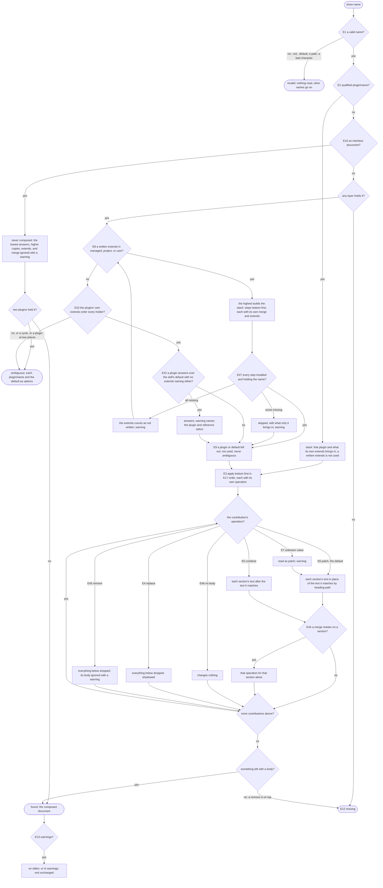
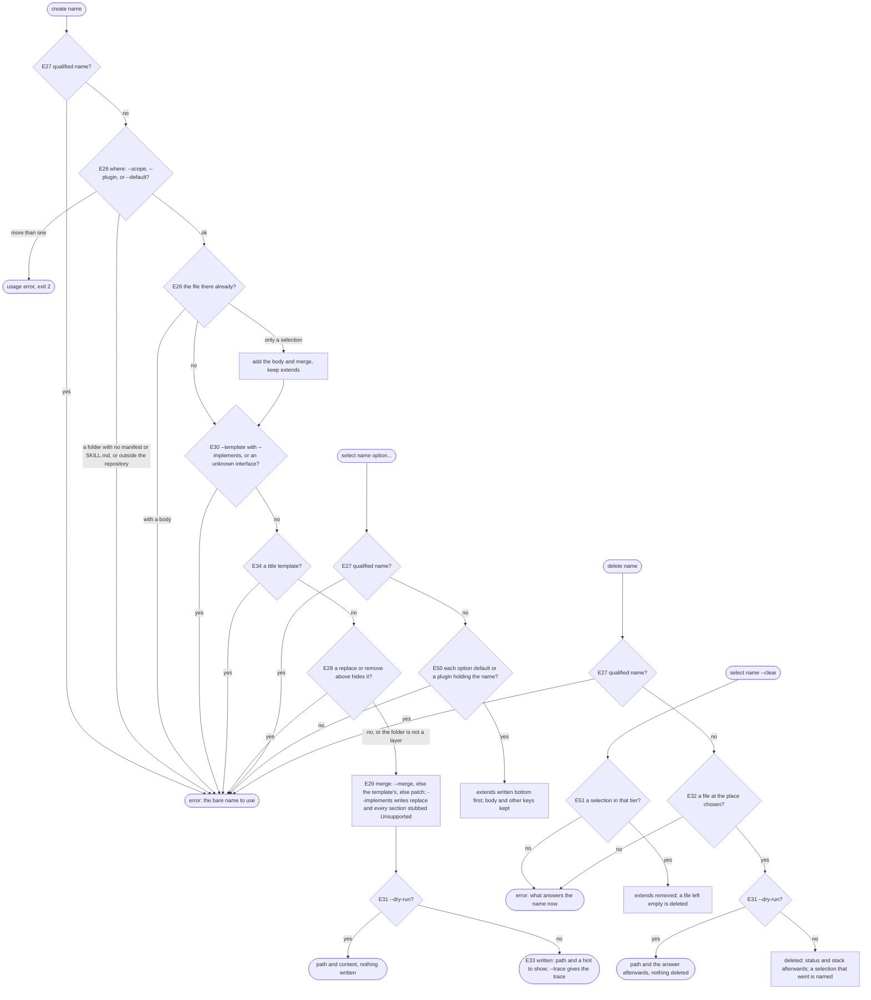
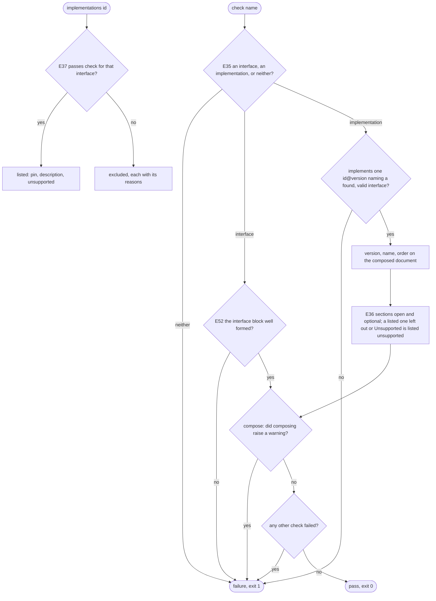

# references — decision graph

Decisions a consumer can observe when a name is resolved, found, written, or checked. Criteria in
[README.md](./README.md) cite the edge IDs. E53 was proposed and dropped; it is not reused.

## Resolving a name

| Edge | Decision | Outcome |
| --- | --- | --- |
| E12 | every name `found`, or `where` on an ambiguous name | exit 0; a name not `found`, a failed check, or a refused write exits 1; a usage error exits 2 |
| E13 | a warning | never changes stdout or the exit code |
| E40 | the output format | only the fields that answer; `--metadata` and `--trace` add the rest (R38) |
| E41 | a failure or warning | a stable `code`; the wording is not a contract |

## Reading layers

| Edge | Decision | Outcome |
| --- | --- | --- |
| E14 | the project, user, and managed tiers | `.agents/references/` from the root up to the repository root; `~/.agents/references/`; `references/` in each detected harness's managed folder |
| E15 | the plugin tier | enabled plugins of the detected harness, plus declared (not transitive) package dependencies that ship `references/` |
| E43 | `--default <skill folder>` | `<skill folder>/references/<name>.default.md` read as the `default` tier; an old `references/<name>.md` copy is not |
| E22 | a `governances/` folder | never read |
| E17 | a layer skipped for a reason | in the trace with its reason; adds no contribution |
| E11 | `--trace`, or `where` | every layer with its outcome; `where` gives the places to write and the heading paths below |

## Finding names

| Edge | Decision | Outcome |
| --- | --- | --- |
| E18 | `list` | one row per name; `--trace` gives one per layer and per skill default; a pattern keeps exact matches |
| E19 | `search` | each name resolved as `show` would; match kinds ranked `name` to `body`, then by name |
| E20 | no match | an explicit zero, exit 0 |
| E48 | skill defaults | found in the skill folders the detected harness reads; on an unverified harness none, and the answer says so |

## The skill's fallback

| Edge | Decision | Outcome |
| --- | --- | --- |
| E23 | the command did not run | the skill reads its own `references/<name>.default.md`; never for a name the command reported |
| E49 | `ambiguous`, with a user present | every option listed, the pick written with `reference select`; with no user, not loaded |
| E24 | a fallback used, or a name not loaded | reported to the user with the reason, except a name a `remove` turned off |
| E25 | an `invalid` name | its path is never read |

## Writing

| Edge | Decision | Outcome |
| --- | --- | --- |
| E26 | where `create`, `select`, or `delete` writes | `select`: project or user `<name>.md`; `create` and `delete` also a plugin's or skill's source folder in the repository; never managed or an installed copy |
| E34 | a template with no `description` | written, with a hint |
| E21 | `show`, `where`, `list`, `search`, `check`, `implementations` | write no file |

## Checking interfaces

| Edge | Decision | Outcome |
| --- | --- | --- |
| E38 | `check` with no names | every interface document and implementation; a name several plugins hold also as each `<plugin>/<name>`; each skill's default as its skill loads it |
| E39 | `show` of a document failing its interface | printed, with a warning naming the check |
