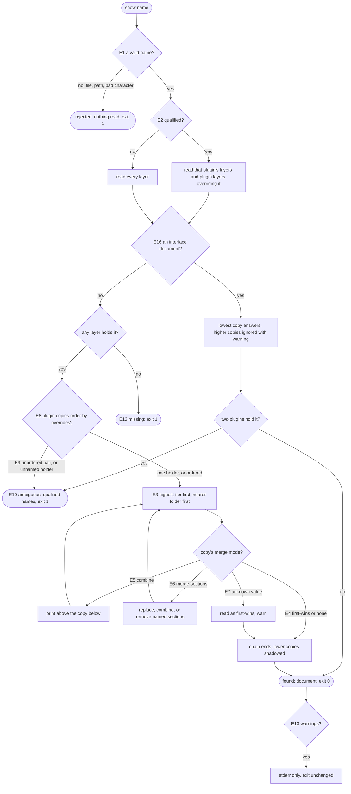
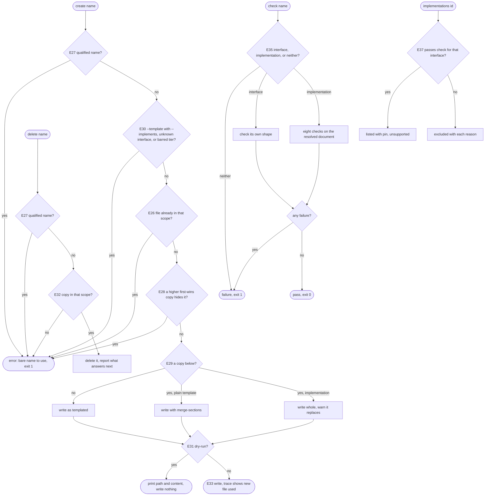

# references — decision graph

Decisions a caller can observe when a name is resolved. Criteria in [README.md](./README.md) cite the edge IDs.

Layer reading, before any name is resolved:

| Edge | Decision | Outcome |
| --- | --- | --- |
| E14 | project tier | `--root` and each folder up to the repository root; `--root` alone with no repository root above |
| E15 | plugin tier | enabled plugins of the detected harness, plus declared (not transitive) package dependencies that ship `references/` |
| E11 | `--trace` given | every layer checked is reported with its outcome |
| E17 | a layer is skipped (MDM policy, no install folder) | appears in the trace with its reason; contributes no copy |
| E18 | `list` | one row per name per layer; a pattern keeps exact matches only |
| E19 | `search` | match kinds ranked `name` to `body`, then by name |
| E20 | no match | explicit zero, exit 0 |
| E21 | any subcommand here | writes no file (barred edge) |
| E22 | a legacy folder holds the name | answers below the tier's `references/` folder; status says to move it |
| E23 | fallback: name `missing` or command did not run | read the caller's copy |
| E24 | fallback used, or a name not loaded | reported to the user with the reason |
| E25 | name rejected | its path is never read; call repeated without it |

Writing, checking, and the consumer contract:

| Edge | Decision | Outcome |
| --- | --- | --- |
| E26–E34 | `create` and `delete` | see the graph; R24 to R32 |
| E35, E36, E37, E38 | `check`, `implementations` | R33 to R36 |
| E39 | `show` of a document failing its interface | printed, warning names the check |
| E40 | `--format json` (not built) | fields in R38 |
| E41 | an unresolved name (not built) | stable `code` |
| E42 | project or user copy over plugin copies (not built) | warning names the plugins |
