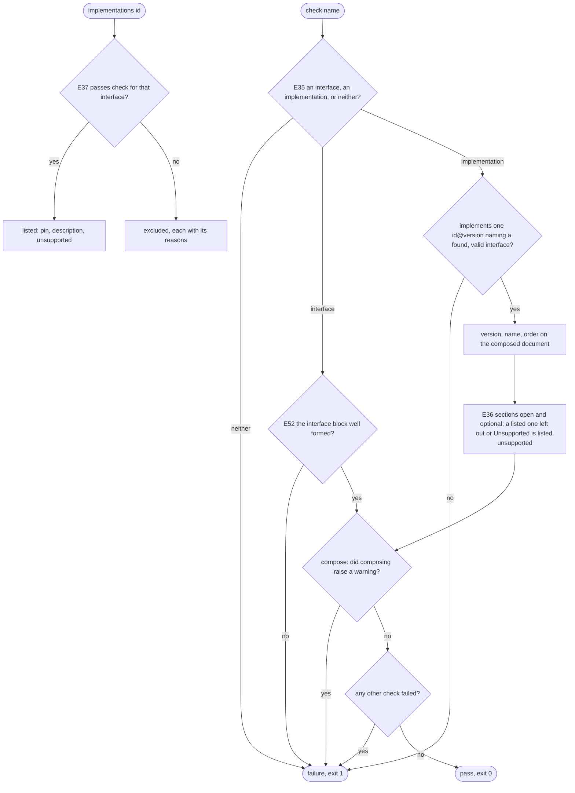

# reference/interfaces — decision graph

Decisions a consumer can observe. Criteria in [README.md](./README.md) cite the edge IDs; the parent's
[graph](../graph.md) holds the edges every child shares.

## Checking interfaces

| Edge | Decision | Outcome |
| --- | --- | --- |
| E38 | `check` with no names | every interface document and implementation; a name several plugins hold also as each `<plugin>/<name>`; each skill's default as its skill loads it |
| E39 | `show` of a document failing its interface | printed, with a warning naming the check |
