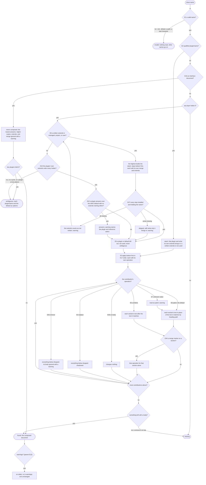

# reference/resolve — decision graph

Decisions a consumer can observe. Criteria in [README.md](./README.md) cite the edge IDs; the parent's
[graph](../graph.md) holds the edges every child shares.

## Resolving a name

## Reading layers

| Edge | Decision | Outcome |
| --- | --- | --- |
| E14 | the project, user, and managed tiers | `.agents/references/` from the root up to the repository root; `~/.agents/references/`; `references/` in each detected harness's managed folder |
| E15 | the plugin tier | enabled plugins of the detected harness, plus declared (not transitive) package dependencies that ship `references/` |
| E43 | `--default <skill folder>` | `<skill folder>/references/<name>.default.md` read as the `default` tier; an old `references/<name>.md` copy is not |
| E22 | a `governances/` folder | never read |
| E17 | a layer skipped for a reason | in the trace with its reason; adds no contribution |
| E11 | `--trace`, or `where` | every layer with its outcome; `where` gives the places to write and the heading paths below |

## Finding names

| Edge | Decision | Outcome |
| --- | --- | --- |
| E18 | `list` | one row per name; `--trace` gives one per layer and per skill default; a pattern keeps exact matches |
| E19 | `search` | each name resolved as `show` would; match kinds ranked `name` to `body`, then by name |
| E20 | no match | an explicit zero, exit 0 |
| E48 | skill defaults | found in the skill folders the detected harness reads; on an unverified harness none, and the answer says so |
