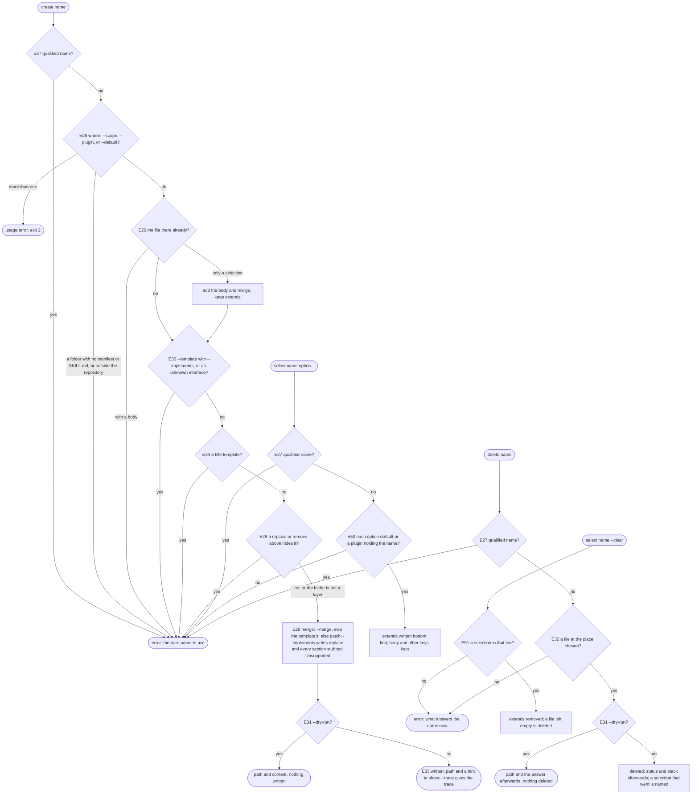

# reference/write — decision graph

Decisions a consumer can observe. Criteria in [README.md](./README.md) cite the edge IDs; the parent's
[graph](../graph.md) holds the edges every child shares.

## Writing

| Edge | Decision | Outcome |
| --- | --- | --- |
| E26 | where `create`, `select`, or `delete` writes | `select`: project or user `<name>.md`; `create` and `delete` also a plugin's or skill's source folder in the repository; never managed or an installed copy |
| E34 | a template with no `description` | written, with a hint |
