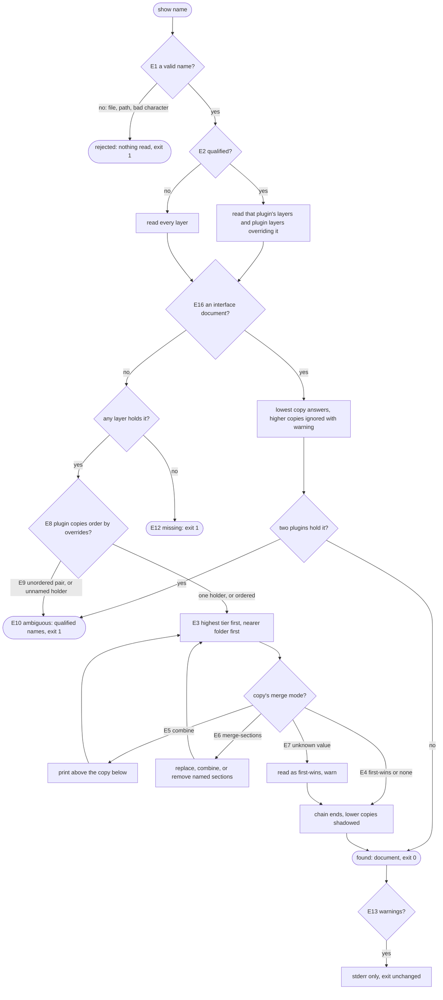

# references — decision graph

Decisions a caller can observe when a name is resolved. Criteria in [README.md](./README.md) cite the edge IDs.

Layer reading, before any name is resolved:

| Edge | Decision | Outcome |
| --- | --- | --- |
| E14 | project tier | `--root` and each folder up to the repository root; `--root` alone with no repository root above |
| E15 | plugin tier | enabled plugins of the detected harness, plus declared (not transitive) package dependencies that ship `references/` |
| E11 | `--trace` given | every layer checked is reported with its outcome |
| E17 | a layer is skipped (MDM policy, no install folder) | appears in the trace with its reason; contributes no copy |
| E18 | `list` | one row per name per layer; a pattern keeps exact matches only |
| E19 | `search` | match kinds ranked `name` to `body`, then by name |
| E20 | no match | explicit zero, exit 0 |
| E21 | any subcommand here | writes no file (barred edge) |
