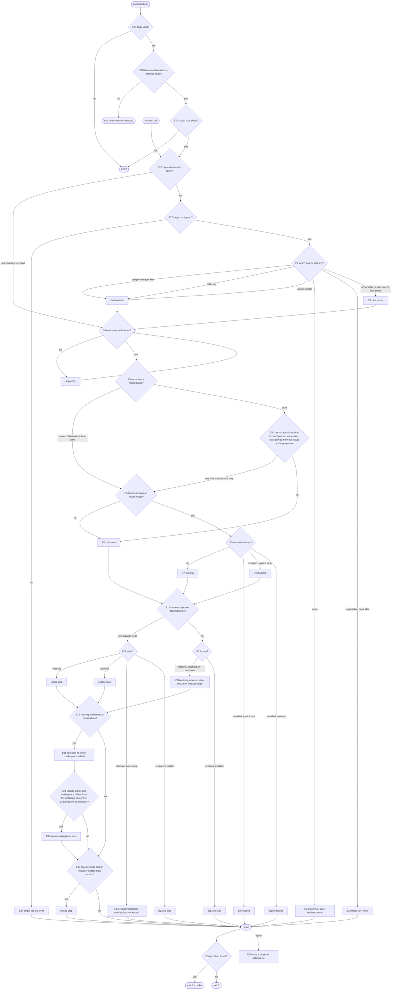

# dependencies — what a plugin needs, what is missing, what to do

## What

A plugin can need other plugins. Claude Code enforces that itself: it installs missing dependencies and refuses to
load a plugin whose dependency is missing or disabled. Every other harness ignores the field, so the plugin installs
and fails later with nothing to say why.

This capability fills that gap. It reads the dependencies a plugin lists, checks them against what the running harness
has installed and enabled, and reports each one's state with the steps the user can run. It is the agent-level
equivalent of `depcheck` or `knip`: one shared answer to "what does this plugin declare, and is it there?".

It is **read-only**. It never installs, enables, or removes a plugin.

**Non-goals:**

- Installing, enabling, or removing plugins.
- Comparing versions. A requested version is reported, never checked.
- Finding dependencies a plugin uses but did not list, or lists but never uses (the `knip` half). Not in v1.
- Reference-keyed overrides: alias, default marker, pin (a separate node, #110).
- Telling whether a marketplace lists a plugin (only its author can fix that), or which marketplaces a harness has
  added. No verified query exists, so the check asks the user.

**Key terms:** see [glossary](../glossary.md). *State* is one of `enabled`, `installed` (installed, no explicit
setting), `disabled`, `missing`, `unknown` (the check cannot tell). *Declaring marketplace* is the marketplace the
declaring plugin was installed from.

**Bare names follow Claude Code.** A dependency with no marketplace resolves only in the declaring plugin's own
marketplace, so a same-named plugin from another marketplace never satisfies it. This is a security measure: the plugin
author chose which plugin is meant. When the declaring marketplace cannot be found (the plugin is not installed, for
example while under development), a bare name is `unknown`, never guessed.

## Use Cases

**Actors.** A1 a user on any harness. A2 `universal-plugin`, the tool that builds and validates plugins. Affected
without invoking it: the plugin author, who wants the list they wrote read the same way everywhere. The agent that a
plugin's text sends to the how-to reference is served by [the shipped how-to reference](#the-shipped-how-to-reference).
Sibling tools (`repobuddy`, `buddy-agent-harness`, `cyber-mux`) that gate a feature on a plugin being present call the
same functions as A2; they need no use case beyond UC2. A2's goal comes from the owner (issue #110 discussion):
`universal-plugin` does at the agent level what `depcheck` and `knip` do for packages.

| Actor | Goal |
| --- | --- |
| A1 user | Learn what a plugin is missing and exactly what to run, on any harness, without the tool changing anything |
| A2 `universal-plugin` | Read a plugin's declared list, and judge declared against installed, with the same meaning as every other tool |

### UC1 — Check a plugin's dependencies (A1)

- **Entry points:** the command `cyber-agentkit dependencies check [--plugin <root>]` (a doctor skill will wrap it, as its own node later); backed by
  `checkPluginDependencies(harness, { pluginRoot })`.
- **Inputs:** `--plugin`, the plugin root (default the current directory, which always exists), and the detected harness. A bare name's declaring marketplace is
  derived from the installed plugin whose install folder is the plugin root; a `declaringMarketplace` passed to the
  function wins over the derived value.
- **Outcome:** each declared dependency with its state, then ordered steps for the user to run, on stdout. Exit codes
  follow AXI, the agent-friendly CLI convention: 0 when every dependency is `enabled` or `installed`; 1 when the intent "this plugin is ready" cannot be
  satisfied; 2 for a usage error. Every problem found carries its own stable `code` (`dependency-missing`,
  `dependency-disabled`, `dependency-unknown`, `manifest-unparsable`); several problems are all listed.
- **Extensions:**
  - The plugin lists no dependencies: zero dependencies, no steps, the report says it declares none, exit 0.
  - A manifest cannot be parsed and no source lists any: no dependencies, the parse error is reported, exit 1.
  - A manifest cannot be parsed but a later source lists some: the list is used and the parse error is reported too,
    exit 1.
  - The harness keeps no install record, or a bare name has no known declaring marketplace: those dependencies are
    `unknown`, with the code `dependency-unknown`, exit 1.
  - The harness has no dependency support (every harness but Claude Code): the same states are reported, and the steps
    are manual and say nothing is resolved for the user.
  - A missing dependency names a marketplace: a step asks the user to check it is added, and to add it if not.
  - On Claude Code, a missing dependency whose marketplace differs from the declaring one (or whose declaring
    marketplace is unknown) also gets the cross-marketplace step: the root marketplace must list it in
    `allowCrossMarketplaceDependenciesOn`, or the user must already have it enabled.
  - No single harness is detected (plain shell, or nested harnesses) and no `--harness <id>` is given: exit 1 with the
    code `harness-not-detected` and a step telling the user to pass `--harness`. An explicit id is used as given.
  - An unknown flag, or a `--plugin` path that does not exist: usage error, exit 2.
  - On Claude Code, an `unknown` bare dependency (declaring marketplace not known) gets one step that says so and asks the
    user to install the plugin from a marketplace or declare `name@marketplace`; no install command is guessed.
  - Disabled and unknown dependencies on a harness without dependency support get a manual step; a missing one also gets
    the marketplace question.
  - Steps come in this order: install or enable, the marketplace question, the cross-marketplace step, then
    `Run /reload-plugins.` (Claude Code only, and only when an install or enable step exists). On any other harness the first
    step says nothing is resolved for the user. A bare name is installed as `name@<declaring marketplace>` when known.

### UC2 — Read and judge a declared list (A2)

- **Entry points:** `declaredPluginDependencies(manifest)`, `readPluginDependencies(pluginRoot)`, and
  `checkPluginDependencies(harness, { dependencies, declaringMarketplace })`.
- **Trigger:** `universal-plugin` build or validate needs the list, or needs to compare it to installed plugins.
- **Outcome:** a list of `{ name, marketplace?, version? }`, read from the first source that lists any, in this
  order: `extensions["io.github.cyber-uni.plugin-manager"]`, then `extensions["org.cyberuni.universal-plugin"]`, then
  `.claude-plugin/plugin.json`.
- **Extensions:**
  - An entry is not a name or a named object: it is skipped and the valid ones are kept.
  - A `dependencies` list passed with a `pluginRoot`: the list is used and the manifest is not read.
  - Neither given: an empty list, no error.
  - No source lists any, or a manifest cannot be parsed: the same empty list and reported error as UC1 describes.

**Surface trace.** `checkPluginDependencies` (UC1, UC2), `readPluginDependencies` (UC1, UC2),
`declaredPluginDependencies` (UC2), the subcommand `dependencies check` and its `--plugin` option (UC1). When both
`pluginRoot` and `dependencies` are passed to the function, `dependencies` wins and `pluginRoot` is not read (UC2).
`declaringMarketplace` serves bare-name resolution (UC1, UC2). The result fields `dependencies[].state`,
`dependencies[].id`, `steps`, and `error` serve UC1 and UC2; `harness`, `supported`, `autoResolved`, `research`, and the read result's `path` are
informational and carry no contract. No other element is unaccounted for.

## Control Flow

## Scenario map

### UC1 — check states

| Edge | Path (Given) | Scenario |
| --- | --- | --- |
| E8 | installed, explicit true | `an installed dependency set to true is enabled` |
| E8 | requested version differs from installed | `a requested version never changes the state` |
| E9 | installed, explicit false | `an installed dependency set to false is disabled` |
| E10 | installed, no entry | `an installed dependency with no setting is installed` |
| E7 | not installed | `a dependency that is not installed is missing` |
| E6 | harness keeps no record | `a harness with no install record reports every dependency unknown` |
| E5 | bare name, same name installed from another marketplace | `a bare name is not satisfied by an install from another marketplace` |
| E5 | named marketplace, install from another | `a named marketplace does not match an install from a different one` |
| E5b | bare name, declaring marketplace known | `a bare name resolves in the declaring marketplace` |
| E5b | passed and derived declaring marketplaces differ | `a passed declaring marketplace wins over the derived one` |
| E5b | bare name, declaring marketplace unknown | `a bare name with no known declaring marketplace is unknown` |

### UC1 — steps

| Edge | Path (Given) | Scenario |
| --- | --- | --- |
| E12 | Claude Code, missing | `Claude Code gets an install step and a reload step for a missing dependency` |
| E12 | Claude Code, disabled | `Claude Code gets an enable step for a disabled dependency` |
| E12 | Claude Code, enabled and installed | `nothing missing or disabled gives no steps` |
| E12 | Claude Code, unknown bare name | `Claude Code explains an unknown bare dependency instead of guessing a marketplace` |
| E17 | Codex, missing | `a harness without dependency support gets no reload step` |
| E18 | Codex, missing | `a harness without dependency support starts with the nothing-resolved step` |
| E13 | Codex, record exists, dependency missing | `a harness without dependency support gets a manual step for a missing dependency` |
| E13 | Codex, record exists, dependency disabled | `a harness without dependency support gets a manual step for a disabled dependency` |
| E13 | Codex, record exists, dependency enabled | `a harness without dependency support gets no step for an enabled dependency` |
| E13 | Cursor, no install record | `a harness without dependency support or a record says nothing is resolved and lists manual steps` |
| E14 | Claude Code, missing, names a marketplace | `a missing dependency that names a marketplace asks the user to check it is added` |
| E14 | Codex, missing, names a marketplace | `a harness without dependency support asks the user to check the marketplace of a missing dependency` |
| E14 | Claude Code, disabled, names a marketplace | `a disabled dependency that names a marketplace gets no marketplace question` |
| E14 | Claude Code, missing, bare name | `a missing dependency with no marketplace gets no marketplace question` |
| E22 | Claude Code, missing, marketplace differs from declaring | `Claude Code adds the cross-marketplace step for a missing dependency in another marketplace` |
| E22 | Claude Code, missing, declaring marketplace unknown | `a missing dependency with an unknown declaring marketplace gets the cross-marketplace step` |
| E12 | Claude Code, missing bare name, declaring marketplace known | `a missing bare dependency is installed from the declaring marketplace` |
| E15 | Claude Code, missing, different marketplace | `the steps come in the order install, marketplace question, cross-marketplace, reload` |
| E21 | Claude Code, missing, marketplace equals declaring | `a missing dependency in the declaring marketplace gets no cross-marketplace step` |
| E21 | Codex, missing, names a marketplace | `a harness without dependency support never gets the cross-marketplace step` |

### UC1 — the doctor command

| Edge | Path (Given) | Scenario |
| --- | --- | --- |
| E16 | Claude Code, something missing | `the check command exits 1 when a dependency is missing` |
| E16 | Claude Code, something disabled | `the check command exits 1 when a dependency is disabled` |
| E16 | Claude Code, installed with no setting | `the check command exits 0 when a dependency is installed with no setting` |
| E16 | Claude Code, all enabled | `the check command exits 0 when every dependency is enabled` |
| E16 | Cursor, no record | `the check command exits 1 with dependency-unknown when the harness keeps no install record` |
| E16 | Claude Code, a missing dependency and an unparsable manifest | `the check command lists every problem it finds with its own code` |
| E3 | command run, unparsable manifest, no other source | `the check command exits 1 with manifest-unparsable for an unparsable manifest` |
| E3b | command run, unparsable manifest, later source all enabled | `the check command exits 1 with manifest-unparsable even when the later source is all enabled` |
| E2 | command run, plugin lists nothing | `the check command says a plugin declares no dependencies and exits 0` |
| E28 | no harness detected, no --harness | `the check command exits 1 with harness-not-detected when no harness is detected` |
| E28 | --harness given | `the check command uses an explicit --harness` |
| E23 | unknown flag | `the check command exits 2 for an unknown flag` |
| E24 | --plugin path does not exist | `the check command exits 2 when the plugin root does not exist` |
| E5b | command run, plugin installed from the declaring marketplace | `the check command resolves a bare name in the marketplace the plugin was installed from` |
| E5b | command run, plugin folder not installed | `the check command reports a bare name as unknown when the plugin is not installed` |
| E24 | no --plugin, cwd holds a plugin | `the check command reads the current directory when --plugin is omitted` |
| E20 | any (barred edge) | `the check command changes no plugin or settings file` |

### UC2 — read a declared list

| Edge | Path (Given) | Scenario |
| --- | --- | --- |
| E1 | plugin-manager key lists some | `the plugin-manager key wins over every other source` |
| E1 | only the older key lists some | `the older universal-plugin key is read when the plugin-manager key lists none` |
| E1 | only .claude-plugin lists some | `the Claude Code manifest is read when no extension key lists any` |
| E1 | string and object entries | `string and object entries keep their marketplace and version` |
| E2 | no source lists any | `a plugin that lists nothing reports no dependencies and no error` |
| E3 | unparsable manifest, no other source | `an unparsable manifest yields no dependencies and a reported error` |
| E3b | unparsable manifest, a later source lists some | `an unparsable manifest does not hide a later source but is still reported` |
| E4 | a malformed entry beside a valid one | `a malformed entry is skipped and its valid sibling kept` |
| E26 | list given with a plugin root | `a given dependencies list is used and the plugin root is not read` |
| E27 | neither list nor root | `neither a list nor a plugin root gives an empty list and no error` |

<!-- open: round-6 spec-judge findings left at draft by the owner's decision (accepted as-is, no freeze). Builder: assert the reload step after a Claude Code enable-only case and its absence for the unknown-bare case, with E17 map rows for both. Architect: add an "entries remain?" exit to the entry loop so an empty or all-skipped list reaches the report; separate per-dependency decisions from the aggregate reload (E17) and nothing-resolved (E18) steps; qualify "the first step says nothing is resolved" with "when any step exists". Observations: record the `src/commands.ts` home of the command; list the global `--format` flag and the `HarnessEnvironment` options as informational; record the silent skip of a malformed entry as a known limitation. -->

## The shipped how-to reference

The Markdown document `packages/cyber-agentkit/references/plugin-dependencies.md`, shipped in the plugin and loaded by
name through the `reference` skill (`reference show plugin-dependencies`). A plugin's own README or skill points an
agent at it when a plugin it needs is missing.

It tells an agent what a plugin declares and where, how to run the check, and the steps per harness: Claude Code, which
resolves dependencies itself, and every other harness, where nothing is resolved for the user and no install command is
given. It is written from the same facts as the check above, by `renderDependencyReference()`; a repository test fails
while the committed file differs from the generator's output. It carries no suite: its text is checked by that test,
not by scenarios.

## References

- Agent Plugins 1.0.0 section 8: client data goes under a reverse-domain key in `extensions`. Backs the extension key
  (decision `0001`, evidence E-DEP-7).
- Claude Code installs missing dependencies, refuses to load without them, and resolves a bare name in the declaring
  plugin's marketplace: E-DEP-1, E-DEP-2, E-DEP-3.
- No other harness has a dependency field: E-DEP-4, E-DEP-5.
- AXI principle 6: exit 0 success, 1 error, 2 usage error; errors go to stdout in the structured format
  (kunchenguid/axi, fetched 2026-10-18).
- The doctor's independent, listable results follow `flutter doctor` and `brew doctor`. See
  `.research/plugin-dependency-prior-art` (E-PA-*).
