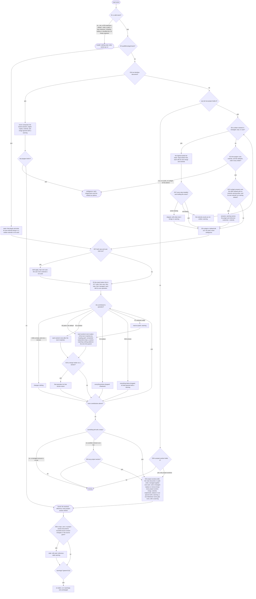

# reference/resolve — decision graph

Decisions a consumer can observe. Criteria in [README.md](./README.md) cite the edge IDs; the parent's
[graph](../graph.md) holds the edges every child shares.

## Resolving a name

## Reading layers

| Edge | Decision | Outcome |
| --- | --- | --- |
| E14 | the root and the `repo`, `project`, `user`, and managed tiers | the root: `--root` (refused, `root-missing`, when it does not exist), else the nearest folder up that holds `.git` (a folder, or a file in a git worktree), else the working folder; `repo`: the root's `.agents/references/`; `project`: each `.agents/references/` strictly below it that git does not ignore (by any ignore file git reads); `~/.agents/references/`; `references/` in the current harness's managed folder only, and none when detection names no harness or more than one |
| E15 | the plugin tier | enabled plugins of the detected harness, plus declared (not transitive) package dependencies that ship `references/` |
| E43 | `--default <skill folder>` | `<skill folder>/references/<name>.default.md` read as the `default` tier; an old `references/<name>.md` copy is not |
| E22 | a `governances/` folder | never read |
| E17 | a layer skipped for a reason | in the trace with its reason; adds no contribution |
| E11 | `--trace`, or `where` | every layer with its outcome, project sections, and a generated document's sources; `where` gives the places to write, with `--in` a folder's, and the heading paths |

## Finding names

| Edge | Decision | Outcome |
| --- | --- | --- |
| E18 | `list` | one row per name; `--trace` gives one per layer and per skill default; a pattern keeps exact matches |
| E19 | `search` | each name resolved as `load` would, and each project section searched (its match carries its `folder`); match kinds ranked `name` to `body`, then by name |
| E20 | no match | axi's empty answer, an explicit zero, exit 0 |
| E48 | skill defaults | found in the skill folders the detected harness reads; on an unverified harness none, and the answer says so |

## Renames

| Edge | Decision | Outcome |
| --- | --- | --- |
| E65 | a name or a file name listed in another name's `aliases` (an interface's older ids included), and held by no contribution as its own | resolves the new name, with a `reference-renamed` warning; listed by two names, `ambiguous` |
