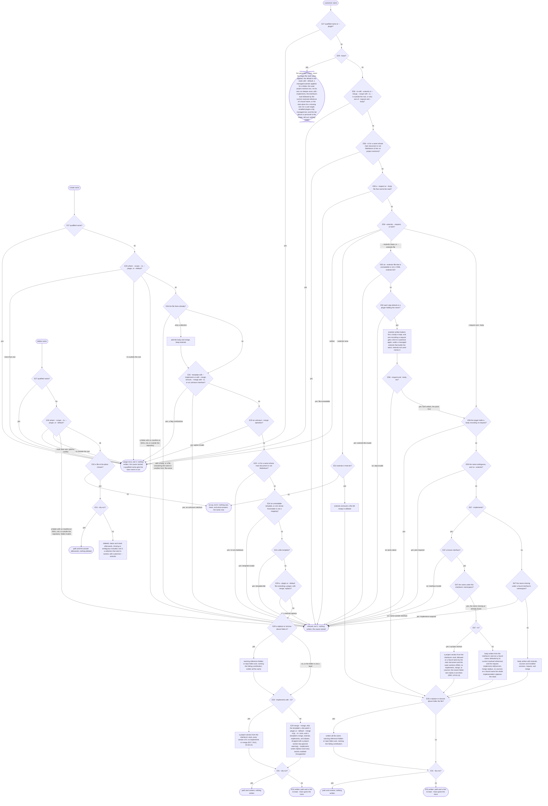

# reference/write — decision graph

Decisions a consumer can observe. Criteria in [README.md](./README.md) cite the edge IDs; the parent's
[graph](../graph.md) holds the edges every child shares.

## Writing

| Edge | Decision | Outcome |
| --- | --- | --- |
| E26 | where `create`, `customize`, or `delete` writes | `customize`: the `repo`, `user`, or a folder's `<name>.md`; `create` and `delete` also a plugin's or skill's source folder in the repository; never managed or an installed copy |
| E34 | a title template; a template with no `description` | refused; written, with a hint |
| E67 | `customize` with `--implements`, or a `missing` name under a found interface's namespace without it | the base is the stub, followed by the current resolved reference of a found name, and the document records `implements` with `merge: replace`; without `--implements`, refused `implements-required`; an unknown interface is refused `interface-invalid`, and a name outside the interface's namespace `name-outside-interface` (R111) |
