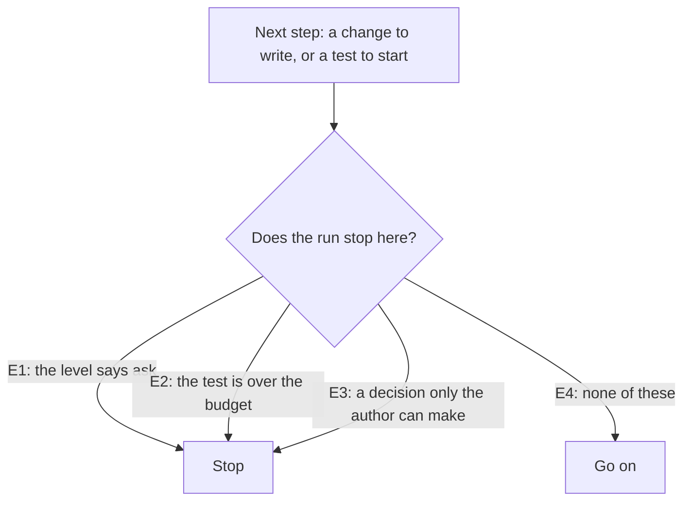

# skill-design — decision graph

The decision every child shares: where a `/skill` run stops. A command gets a graph of its own in its child folder
only where it branches further. Each use case that changes a skill or starts `test` (UC1, UC2, UC4, UC5, UC6) enters
at **Next step**.

| Edge | Decision | Outcome |
| --- | --- | --- |
| E1 | the run's autonomy level (K7) says to ask about this item: every item at `ask`, a change that `check` and `test` do not show safe at `apply-safe` | Stop |
| E2 | the estimate for a `test` run is over the test budget, whichever command starts it, at every level | Stop |
| E3 | the step needs a decision only the author can make: a change to the Intent (such as adopting or extending a skill Research found), to what the skill generalizes over, to an aspect the description says nothing about, or removing or weakening a criterion; at every level, and also when the request names that change | Stop |
| E4 | none of E1 to E3 | Go on: the step is applied and reported |

**Stop.** What a user can see when a run stops, the same on every edge and whether or not anyone is there to answer:

- nothing that depends on the answer was written or run, and every part written before the stop is kept;
- the reply states the run's autonomy line, where the command has one, and reports the work done so far;
- the reply ends with the decision and its options, each lettered.
